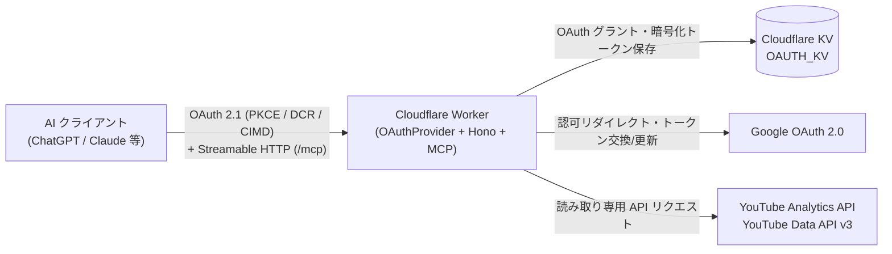
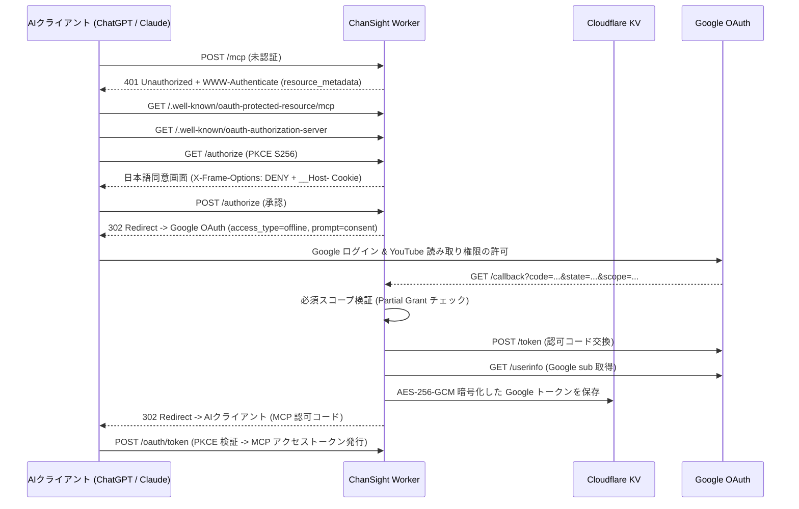

# アーキテクチャ & ファイル構成ドキュメント

ChanSight（チャンサイト）のフォルダ・ファイル構成、認証フロー、MCP 実行フロー、暗号化・ストレージ設計をまとめます。

---

## 1. ディレクトリ・ファイル構成

```text
chansight/
├── .github/
│   └── workflows/
│       └── ci.yml                 # GitHub Actions CI (typecheck / test)
├── docs/
│   └── ARCHITECTURE.md            # 本ドキュメント（設計・ファイル構成）
├── src/
│   ├── index.ts                   # Worker エントリポイント（OAuthProvider 構成・tokenExchangeCallback）
│   ├── config.ts                  # サービス名・URL・必須 Google スコープ・日本語ラベル定義
│   ├── types.ts                   # Env / AuthProps / OAuthHandlerEnv 型定義
│   ├── auth/
│   │   ├── google-oauth.ts        # Google OAuth URL 生成・トークン交換・更新・Partial Grant / invalid_grant 処理
│   │   ├── handlers.ts            # Hono ルータ（/, /privacy, /terms, /health, /authorize, /callback）
│   │   └── token-store.ts         # Cloudflare KV への暗号化 Google トークン保存・自動リフレッシュ
│   ├── crypto/
│   │   └── token-crypto.ts        # Web Crypto API による AES-256-GCM 暗号化 / 復号
│   ├── mcp/
│   │   ├── handler.ts             # ステートレス Streamable HTTP ハンドラ（Durable Objects 不使用）
│   │   └── server.ts              # McpServer ファクトリと 4 つの MCP ツール定義
│   ├── web/
│   │   └── pages.ts               # 日本語 HTML ページ生成（トップ / プライバシー / 利用規約 / 同意 / エラー）
│   └── youtube/
│       ├── client.ts              # YouTube Analytics API & Data API v3 クライアント
│       └── formatters.ts          # 日付解決・再生時間フォーマット・流入元の日本語訳
├── tests/
│   ├── mocks/
│   │   └── cloudflare-workers.ts  # Vitest 用 `cloudflare:workers` スタブ
│   ├── auth-handlers.test.ts      # Web ページ・同意画面・Partial Grant・コールバック単体テスト
│   ├── google-oauth.test.ts       # Google OAuth URL・スコープ検証・invalid_grant 単体テスト
│   ├── mcp-tools.test.ts          # ステートレス MCP JSON-RPC・4 ツール・エラー応答テスト
│   ├── token-crypto.test.ts       # AES-256-GCM 暗号化・改ざん検知テスト
│   ├── token-store.test.ts        # KV 暗号化保存・期限切れ自動更新・失効時削除テスト
│   ├── web-pages.test.ts          # HTML ページ・Limited Use 文言テスト
│   └── youtube-client.test.ts     # YouTube API クライアント・URL 正規化・401 リトライ・Workers fetch テスト
├── .dev.vars.example              # ローカル開発用シークレットのテンプレート
├── .editorconfig                  # エディタ共通フォーマット設定
├── .gitattributes                 # 改行コード（LF 統一）・バイナリ属性設定
├── .gitignore                     # Git 除外設定（.dev.vars / .wrangler 等）
├── CONTRIBUTING.md                # コントリビューションガイド
├── LICENSE                        # MIT ライセンス
├── README.md                      # プロジェクト概要・セットアップ手順
├── SECURITY.md                    # セキュリティポリシー
├── package.json                   # 依存パッケージ・npm スクリプト
├── package-lock.json              # 依存ロックファイル
├── tsconfig.json                  # TypeScript 厳格型チェック設定
├── vitest.config.ts               # Vitest 設定
├── wrangler.jsonc                 # Cloudflare Workers 設定（本番デプロイ用）
└── wrangler.example.jsonc         # セルフホスト向け Wrangler 設定テンプレート
```

---

## 2. システムアーキテクチャ

Cloudflare の無料枠で安定運用するため、**単一 Cloudflare Worker + 単一 KV Namespace（`OAUTH_KV`）** のみで構成し、Durable Objects は一切使用していません。



---

## 3. OAuth 2.1 + Google OAuth 認証フロー

`@cloudflare/workers-oauth-provider` が MCP クライアント向けの OAuth 2.1（RFC 9728 Protected Resource Metadata / RFC 8414 Authorization Server Metadata / RFC 7591 DCR / CIMD / PKCE S256）を処理し、実際のユーザー認証は Google OAuth に委譲します。



---

## 4. ステートレス MCP 実行フロー（`/mcp`）

1. `OAuthProvider` が `Authorization: Bearer <token>` を検証し、認証済みユーザー ID（`ctx.props.userId`）を `mcpApiHandler` へ渡します。
2. `src/mcp/handler.ts` がリクエストごとに新しい `McpServer` と `WebStandardStreamableHTTPServerTransport`（`sessionIdGenerator: undefined`, `enableJsonResponse: true`）を生成します。
3. ツール実行時、`token-store.ts` が KV から暗号化済み Google トークンを復号します。期限切れ間近（残り 60 秒未満）の場合はリフレッシュトークンで自動更新して KV に再保存します。
4. `YouTubeClient` が YouTube Analytics API / YouTube Data API v3 を呼び出し、JSON レスポンスを返却後、トランスポートとサーバーインスタンスを即座に破棄します。

---

## 5. ストレージと暗号化設計（`OAUTH_KV`）

| キー種別 | 管理者 | 保存内容・保護方式 |
| --- | --- | --- |
| `client:*`, `grant:*`, `token:*` 等 | `@cloudflare/workers-oauth-provider` | トークンはハッシュ化保存、`props` はトークン鍵で暗号化 |
| `google_tokens:<userId>` | `src/auth/token-store.ts` | Google `accessToken` / `refreshToken` / `expiresAt` / `scope` の JSON を `TOKEN_ENCRYPTION_KEY` で **AES-256-GCM 暗号化**（`v1.<iv>.<ciphertext>`、ランダム 12 バイト IV） |

※ YouTube Analytics の集計結果・動画メタデータは KV や DB に一切永続保存しません。

---

## 6. 主なエラーハンドリング

- **部分許可（Partial Grant）**: `/callback` でクエリおよびトークンレスポンス双方の `scope` を検証し、`yt-analytics.readonly` または `youtube.readonly` が欠けていた場合は認可を完了せず、日本語の案内画面と元の OAuth パラメータを引き継ぐ「再ログイン」リンクを返します。
- **トークン失効（`invalid_grant`）**: パスワード変更やアクセス権取り消し等で Google のリフレッシュトークンが失効した場合、KV 内の古いトークンを削除し、ツール応答では AI クライアントに「Google アカウントの再連携が必要です」と明確に伝わる日本語エラーを返します。また MCP のリフレッシュトークン更新時にも `OAuthError("invalid_grant")` を返してグラントをクリーンに失効させます。
- **突発的な YouTube API 401**: ローカル有効期限内でも YouTube API が 401 を返した場合は 1 回だけ強制リフレッシュして自動リトライします。
